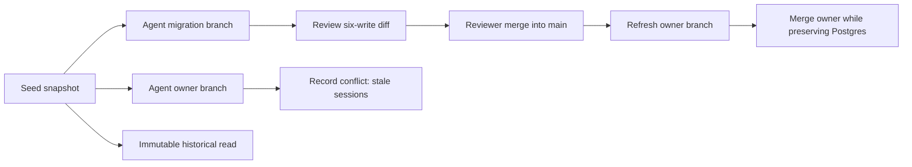

# Omnigraph Agent Branches

Show why isolated graph branches prevent a stale agent write from erasing another agent's work. A six-write database migration lands first. A second agent's stale update conflicts at the **record** level, even though it intended to change another field. Refreshing from main preserves both the Postgres migration and the ownership assignment. A historical snapshot still shows Redis and the original empty owner.

The runnable Python replay is an independent teaching model. The repository also contains a native graph schema, JSONL data, query, and an argument-safe adapter for the public [Omnigraph CLI](https://github.com/ModernRelay/omnigraph).

## Run

Python 3.10+; no Python packages required.

```powershell
python -B app.py demo
python -B -m unittest discover -s tests -v
python -B app.py native-plan --target artifacts/graph.omni
```

The demo creates no files. It emits the six changed records, rejected stale merge, final graph, and initial snapshot as JSON. Local reviewer/branch ownership checks demonstrate the policy concept; they are not a server authentication boundary.

For the actual local engine, install the CLI using its [official installation guide](https://github.com/ModernRelay/omnigraph/blob/032179335bb2fd5373aa097f972b30482e7787df/docs/user/install.md), then use a fresh path:

```powershell
python -B app.py native --target artifacts/graph.omni
```

This explicitly creates and mutates a **new local graph**, using subprocess argument arrays without a shell. It refuses an existing target. It loads the seed, creates two branches from main, loads the agents' changes, displays the diff, merges the migration, requires `divergent_update` for the stale branch, creates a refreshed branch, and queries both current and seed snapshots. The seed commit comes from the load receipt, not from an assumed head. Failures stop the walkthrough. The adapter does not delete branches or retry writes automatically.

## Architecture



## Code map

| File | Responsibility |
|---|---|
| `app.py` | Independent replay graph, atomic record-level three-way merge, immutable snapshot reads, native CLI plan/runner and CLI entry point. |
| `schema.pg` | Native keyed Component, Decision and Issue nodes plus Affects/Supersedes edges. |
| `queries.gq` | Native component projection used for current and historical reads. |
| `fixtures/seed.jsonl` | Fictional sessions/billing components, existing decision and migration issue. |
| `fixtures/claude.jsonl` | Six native migration writes: component, decision, two links, supersession link and issue closure. |
| `fixtures/codex.jsonl` | Stale full-record ownership update. |
| `fixtures/codex-2.jsonl` | Refreshed ownership update preserving the migrated store. |
| `tests/test_app.py` | Atomic conflict, disjoint merge, copy isolation, replay policy, native argv/receipt and CLI tests. |
| `requirements.txt` | Standard-library requirement and optional CLI dependency. |
| `.gitignore` | Generated graph data, caches and local configuration exclusions. |

## Source and limits

Native contracts were checked against upstream revision [`0321793`](https://github.com/ModernRelay/omnigraph/tree/032179335bb2fd5373aa097f972b30482e7787df), including [quickstart](https://github.com/ModernRelay/omnigraph/blob/032179335bb2fd5373aa097f972b30482e7787df/docs/user/quickstart.md), [merge behavior](https://github.com/ModernRelay/omnigraph/blob/032179335bb2fd5373aa097f972b30482e7787df/docs/user/branching/merge.md), and [load semantics](https://github.com/ModernRelay/omnigraph/blob/032179335bb2fd5373aa097f972b30482e7787df/docs/user/mutations/index.md). No upstream engine implementation is vendored.

The Python model supports this insert/update scenario, not general schema constraints, deletions, durable storage or the native engine's complete commit-DAG rules. Native CLI execution was not verified because the CLI was unavailable; its adapter tests replay process responses. No server, Cedar policy deployment, real agents, provider calls or scalability benchmark was run. A served deployment must resolve identity from its authenticated credentials; a local `--as` actor is not a substitute for that boundary.
